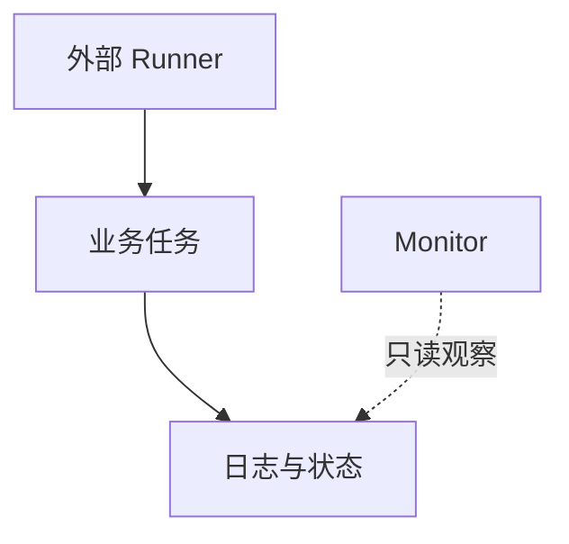

# pi-cc-monitor

> Monitor 只观察文件、外部 Runner 的任务状态和 WebSocket；不启动、取消、重启或接管业务任务。

**0.18.0 是破坏性接口变更。** 从 0.17.x 升级后，`command`、顶层 `ws` 和 `source.monitorId` 不再接受；旧的命令观察不会自动转成 Runner 任务，需要按下面的来源重新建立观察。

## 安装与开发

```bash
pi install npm:pi-cc-monitor
```

本地开发可将仓库软链接到扩展目录。只有主动 `/reload` 或重新启动 Pi 才加载修改；旧实例在退出／重载时仍按旧代码清理它托管的任务。本次重构不做旧任务移交。

```bash
ln -sfn "$PWD" ~/.pi/agent/extensions/pi-cc-monitor
```

## 职责



- Runner 用原生 CLI 提交、托管、查询和取消任务；模型根据用户／项目约定及实际执行机器上的工具选择。
- Monitor 只拥有观察器、读取句柄、SSH／WebSocket 连接和可回收观察副本。
- Pi 退出、重载、切换会话，Monitor 停止／超时／输出过多，或绑定的 Loop 结束，都只结束观察。外部任务的期限和取消由 Runner 决定。
- 不自建 Runner、后台会话 Supervisor 或 `job_*` 执行工具，不修改原生 Bash。模型的 Runner 使用约定不是不可绕过的 Shell 沙箱。

完整约定：[观察协议 v1](docs/OBSERVATION_PROTOCOL.md)。提交示例：[外部 Runner](docs/RUNNERS.md)，含 tmux、systemd、Slurm 和普通退出记录脚本。

## 工具

| 工具 | 职责 |
| --- | --- |
| `Monitor` | 建立文件、外部任务状态或 WebSocket 观察；update 只改规则／通知 |
| `monitor_stop` | 停止观察资源；绝不向业务任务发送信号或取消命令 |
| `monitor_list` | 返回观察状态及独立的外部任务报告，不启动或重启任务 |

三个工具都有 JSON Schema `outputSchema` 和匹配的 `structuredContent`，可供 codemode 直接消费。`taskId` 是观察实例 ID，不是 Runner 的任务 ID。外部结果位于 `job.state`、`job.exitCode`，不再与观察辅助进程的结果共用字段。

### 观察来源

```json
{"source":{"kind":"file","stdout":"runs/build/stdout.log","stderr":"runs/build/stderr.log"},"description":"build errors","watches":[{"id":"errors","text":"ERROR","stream":"both"}]}
```

```json
{"source":{"kind":"job","manifest":"runs/train-01/job.json"},"description":"training result","persistent":true}
```

```json
{"source":{"kind":"job","host":"192.168.1.2","manifest":"/work/project/runs/train-01/job.json"},"description":"server training","mode":"completion"}
```

```json
{"source":{"kind":"ws","url":"wss://example.com/events"},"description":"event feed"}
```

`file` 至少提供 stdout 或 stderr。`job` 的 manifest 必须已存在且有效；任务身份、日志／状态位置按 v1 协议读取，不执行其中的额外字段。远程源使用已有 SSH 配置，要求远端 POSIX 环境已有 Python 3；源路径是绝对路径，固定辅助程序只读文件、不安装软件、不接受任意远程命令。

`from: "tail"` 默认回放每条来源最近最多 64 KiB，然后读取新增字节；`from: "now"` 跳过已有字节。文件轮转、截断或失联时会显示 `sourceGap`，不能把观察副本当作完整原始日志。

读取使用有界轮询：本地 250 ms、远程 1000 ms 一跳，每跳每流默认最多 8 次 64 KiB 读取（≤512 KiB，约 50 ms 预算）；未追上时立即排下一跳，所以普通突发（编译、`set -x`、训练日志爆发）通常会完整追上，而不是只留尾部。未追上的下一跳约 15 ms 后重排（追赶期不让事件循环空转）；单次积压超过 8 MiB 才放弃追赶、跳到来源保留的尾部，并立刻发一条 context 级 `sourceGap` 提示（同一观察 30 秒内最多一次），不必等到观察结束。终态报告会先把剩余尾部读完再投递。

`from: "now"` 跳过的是建立观察时已存在的字节；如果某个日志到那时还不存在，它之后出现的内容会从头读起。读取游标保留新 offset 前最多 64 字节的已验证窗口，短追加也会保留并积累旧 guard；同 inode 重写检测仍是尽力而为，不是完整文件审计。

### 模式与期限

| 参数 | 语义 |
| --- | --- |
| `mode: events` | 匹配到来源输出时发送事件（对 `job` 来源同样会在任务进入有效终态时完成观察并附带日志尾部，无需再开 `completion`）；默认观察 stdout，可用规则选择 stderr/both |
| `mode: completion` | 只安静等待外部任务的有效终态，不发送实时输出；只支持 job 来源 |
| `timeout_ms` | 只结束观察：`file`/`ws` 默认 5 分钟、上限 1 小时；`job` 来源（含 `events` 与 `completion`）默认 30 分钟、上限 2 小时 |
| `persistent` | 本 Pi 会话内不设观察超时，不代表任务持久化或跨进程保留观察器 |
| `loopPrompt` | 请求绑定 Loop；当前活动身份优先，旧无身份调用仅按唯一 prompt 兼容匹配，结束只停止该观察 |
| `notify.output` | turn/context/none，仅控制实时输出；终态独立投递 |
| `watches` | events 直接匹配源输出，literal、最多 20 条、stdout/stderr/both、once/repeat；[] 静音 |

job 默认 completion，其余默认 events。日志 EOF、SSH／WebSocket 断开、观察停止不是业务终态。缺失／损坏／身份不匹配的 status.json 报告 unknown；同一原始 run 的有效状态恢复后可以继续观察，不自动重提交。

```json
{"action":"update","id":"observation-id","watches":[],"notify":{"output":"context"}}
```

update 仅接受 action/id/watches/notify，不改变源、期限或运行方式。未改变条件的 once 规则保留命中状态。停止之后的新输出不会继续进入事件流。

与 Loop 新代码联合加载时，新 `/loop` 在建立观察前就取得内部活动身份，首次 wakeup 沿用该身份。一个活动中不同文字的绑定、事件和续期仍指向同一活动；两个同名活动不会被文字误合并或一起停止。首次 wakeup 前取消也会关闭所属观察，迟到消息不能复活已取消身份。通过内部 v1 协议确认绑定，新观察只按活动 ID 停止。仅存在 `cron_delete`、对端未回复或没有给出活动身份时，观察保持独立；旧历史通知的 prompt 兼容在 Loop 一侧保留。建议联合升级两包。新独立观察和已脱离自定步调归属的固定 cron 观察，其异步通知明确标记无归属，不会因同名文字唤醒或取消其他 Loop。这些信息不改变公开工具参数、回执或外部 jobId/runId，独立观察和外部业务任务不受影响。

`monitor_stop` 会同步等待本地收尾：先关闭读取／连接，再等待有界副本 flush（最多约 2 秒）并确认辅助进程组消失（最多再约 1 秒加轮询）。远程 SSH 观察最坏约 4 秒才返回，这不是卡死，也不会因此取消外部任务；未确认时返回 `stopped: false` 并保留可重试记录。模型主动调用 `monitor_stop` 时，未发出的匹配行直接随同步回执（`finalLines`）返回，不再重复投递异步停止卡片自唤醒；用户在 `/tasks` 面板手动停止仍通过安全边界通知模型。

## 等待与结果

启动回执只证明建立了观察，不证明任务启动或完成。模型应继续独立工作；只剩等待时简短交接，不靠轮询、sleep、重读日志或重复提交任务等待。

有效终态是外部写入者的报告，不是 Monitor 独立审计过操作系统进程。结果到达后仍应核对 Runner 及所需输出／checkpoint；所依赖的多个任务全部完成并验证后才能报告最终结果。

终态继续在响应／整个工具批次结束的 `turn_end` 安全边界投递；最多请求一次续接，已有工具和排队输入自然满足，不中断当前工作。Esc 不丢弃已完成结果，也不重启被中断的回复。idle／settled、手动 compaction 与缺失事件的保守兜底仍保留。Pi 的投递调用同步抛错时，结果继续留在会话内队列。正常空闲时批量投递最后一条的唤醒若失败，仍空闲且未开始新回合或手动会话操作时重试一次；其他兜底只追加上下文。交给 Pi 不等于跨重启保证或模型已读。通知和日志是外部数据，不是用户回复。

没有自动任务发现、观察恢复、训练重启或 Pi 退出期间的模型通知。重连时显式使用原 manifest/jobId/runId，不重新启动一份任务。

## 现有界面

保留现有 `/tasks` 浮层、布局、键盘／鼠标交互、宽度／主题处理和卡片样式。重名时只注册 `/cc-tasks`；不新增 Runner 控制面板或取消训练按钮。

列表是观察器；详情分别显示观察状态、外部 job 报告（仅 job 来源）、观察规则、投递、存活期和副本日志。`x` 先确认影响范围，再停止观察；打开、刷新、关闭面板不启动模型。Loop 页仍由 Loop 自己提供。本包不修改 Loop 的界面或调度核心。

底部仍显示活跃实例数，如 `2 monitors`，不是业务进程数。只有实际状态变化才更新，不每行输出重绘。旧保存消息可只读展示；没有旧运行对象恢复或执行兼容层。

## 输出预算与回收

- events 保留 200ms 批处理、单行 500 字符、完整通知约 3000 字符的有界正文及独立事件计数。
- 每来源限流及会话级 20 条／60 秒输出预算保留；持续过量可以停止观察，绝不停止外部业务任务。终态不被普通输出预算吞掉。
- 观察副本写入失败或超过 4 MiB 待写积压时降级日志，发一次 context-only 基础设施告警；不取消外部任务。源读取错误与副本写入错误分别报告。
- 默认观察 stdout/stderr 副本合计上限 20 MiB，两条流各半；WebSocket 一条流使用完整预算。每条流最多两个分段：`.1` 在前、当前在后。真正丢弃旧副本字节时标记 `logTruncated`。
- `sourceGap` 表示有源字节未观察／未回放，与副本轮转导致的 `logTruncated` 不同。它是观察中的诊断，不是结束：卡片标题是 `Observation Gap`，不带结束态的耗时和清理信息。终态通知也会再说明。读取原任务信息时使用 Runner 的稳定日志。
- 私有目录 `<tmp>/pi-cc-monitor-*/<观察ID>/` 中的资源-free、终态已交付产物保留至少 10 分钟读取缓冲；默认 3 天保留、200 MiB 安全可回收池软预算。活跃、待交付和清理未确认的数据不强制删除。
- 会话启动、收尾、设置变更及每 30 分钟检查；计时器 unref，退出／重载撤销。只处理可确认归属的目录，不跟随待清理项的链接，不清理未知归属数据。

每个观察的副本只放在私有目录 `<tmp>/pi-cc-monitor-*/<观察ID>/`，Monitor 不向脚本提供 `artifactDir` 一类的工作区。业务启动脚本、manifest、status、原始日志、checkpoint 和正式产物必须放在稳定项目目录。**外部 Runner 日志需要自己的轮转／保留策略，Monitor 的限额并不限制它们。** Monitor GC 不扫描普通业务运行目录、远端 Runner 存储、设置或 Pi 会话。

## /monitor_settings

设置仍独立保存到 `~/.pi/agent/pi-cc-monitor.json`：compactMessages、footer、logRetentionDays、logMaxMiB、logBudgetMiB。没有 Runner 选择设置或共享设置 registry。

```text
/monitor_settings messages on
/monitor_settings footer on
/monitor_settings retention 3  # 天，1–30
/monitor_settings logs 20      # MiB，1–1024，观察副本上限
/monitor_settings budget 200   # MiB，1–10240，可回收观察产物软预算
```

独立数值环境覆盖：`PI_MONITOR_LOG_RETENTION_DAYS`、`PI_MONITOR_LOG_MAX_MIB`、`PI_MONITOR_LOG_BUDGET_MIB`，有效整数优先且不写入文件。保留／预算即时作用于后续清理，日志限额作用于新观察器。

路径跟随 `PI_CODING_AGENT_DIR`。新文件缺失时安全继承旧 pi-cc.json 的本包有效 boolean，已有新文件不补读旧值。`PI_CC_CONFIG_FILE` 显式指定路径则禁用旧文件回读。保存保留未知键、锁和原子写入，失败不覆盖不可读文件。

旧 `PI_CC_FOOTER`、`PI_CC_COMPACT_MESSAGES` 继续兼容，因此仍可同时覆盖 Loop 与 Monitor；默认文件和命令独立。人为给多个插件指定同一个 PI_CC_CONFIG_FILE 也仍可共享文件。本包不写其他插件配置。

## 安全、兼容与测试

- Node.js >=22.19.0；当前核心与回归已验证 Pi 1.6.0、1.6.1。
- Monitor 是文件／网络读取入口，不是沙箱。权限扩展需覆盖它的源路径和主机，而不只是 read/bash 工具名。
- 不替换 Pi 原生工具，不注册动态 prompt／历史修改钩子。工具描述和指南在加载时固定，异步事实只追加到会话末尾。
- 与 pi-cc-extensions 共存，不接管工具行 renderer、不修改它的设置。Loop 可选，设置和调度独立。

```bash
npm test
npm run typecheck
```

可用 `PI_AGENT_DIR` 和 `PI_TYPESCRIPT_PATH` 选择已安装的宿主／编译器，不自动安装依赖。测试使用隔离工作区，不调用真实模型或复制用户认证。

本扩展借鉴 CC 的事件观察与安全结果交付，不复制 CC 的后台会话 Supervisor。执行独立性由外部 Runner 提供，而不是由 Monitor 隐式保留子进程。

## 许可证

MIT
